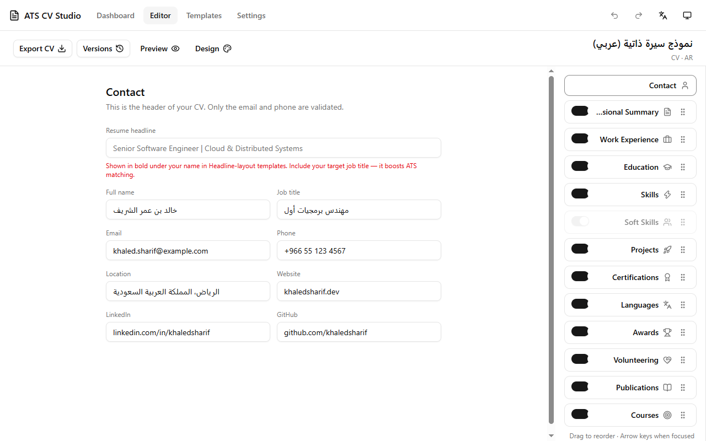

<div dir="rtl">

# ATS CV Studio

[English](README.md) | [Français](README.fr.md) | **العربية**

[]() []() [](https://github.com/ayoubghr-qwerty/ats-cv-studio/actions/workflows/ci.yml) []() []() []() []() []()

**مُنشئ سِيَر ذاتية وخطابات تقديم يعمل دون اتصال بالإنترنت ومتوافق مع أنظمة تتبع المتقدمين (ATS)** — تطبيق سطح مكتب لـ Windows مبني بـ Tauri 2، وبنفس الواجهة تمامًا في نسخة ويب مستقلة. يدعم الإنجليزية والفرنسية والعربية (مع اتجاه من اليمين إلى اليسار بالكامل).



## لماذا ATS CV Studio؟

- **يعمل دون اتصال بالكامل ويحترم خصوصيتك.** لا حساب، لا خادم، لا تتبّع. كل شيء — بما في ذلك تحليل ملفات PDF/DOCX المستوردة — يحدث على جهازك.
- **مصمم للتوافق مع أنظمة ATS.** كل قالب يُنتج عمودًا واحدًا من نص بسيط قابل للتحديد، بخطوط قياسية وتواريخ وعناوين واضحة — تمامًا ما تستطيع أنظمة فرز الطلبات قراءته. لا أيقونات ولا صور ولا أشرطة تقييم تُربك المحلّل.
- **16 قالبًا موزعة على 10 عائلات تخطيط** (كلاسيكي، بسيط، حديث، تنفيذي، تقني، بعنوان بارز، مضغوط، تركيز، وظيفي، احترافي) — كلها مُتحقق منها بأداة فحص قواعد ATS المدمجة.
- **تحكم دقيق في التصميم.** الخط، الهوامش، التباعد، نمط العناوين، الفواصل، نمط التعداد، محاذاة بيانات التواصل، فواصل القوائم أحادية السطر، موضع التواريخ، ألوان التمييز… دون كسر التوافق مع ATS أبدًا.
- **استورد سيرتك الذاتية الحالية.** زوّد التطبيق بملف PDF (نصي) أو DOCX أو JSON واحصل على مستند منظم قابل للتحرير — يُحلّل محليًا، مع خطوة مراجعة قبل حفظ أي شيء.
- **تصدير حقيقي.** تصدير PDF صامت بنص قابل للتحديد في نسخة سطح المكتب (عبر طباعة WebView2)، وWord DOCX بخطوط مطابقة، ونسخ احتياطية JSON للمساحة الكاملة.
- **خطابات تقديم مضمّنة.** نفس نظام التصميم، يعيد استخدام بيانات تواصلك من السيرة الذاتية، ويُصدَّر أيضًا إلى PDF وDOCX.
- **واجهة ثلاثية اللغة.** English، Français، العربية — مع تخطيط كامل من اليمين إلى اليسار للعربية.
- **تراجع/إعادة، حفظ تلقائي، إصدارات.** كل مستند يحتفظ بسجل نسخ يمكن استعادته في أي وقت.

## الميزات

### محرر مباشر

حرّر قسمًا بقسم مع معاينة A4 حيّة، وأعد ترتيب الأقسام بالسحب والإفلات، وشغّل/أوقف كل قسم على حدة، مع تراجع/إعادة وحفظ تلقائي. لكل مستند سجل إصدارات قابل للاستعادة.

### معرض القوالب


تخطيط ممثل واحد لكل عائلة بالإضافة إلى variant حقيقية (بعنوان بارز ×3، مضغوط ×3، تركيز ×2، وظيفي ×2)، كلها معروضة ببيانات نموذجية — ترى الناتج الفعلي لا مجرّد تصميم مبدئي.

### لوحة التصميم


ثلاث عشرة خيار تصميم لكل مستند — القالب، الخط، هوامش الصفحة، التباعد، نمط العناوين، الفاصل، محاذاة التواصل، نمط التعداد، تخطيط القوائم، تنسيق المهارات، تنسيق اللغات، موضع التواريخ، ولون التمييز. ويضمن سكربت `lint:templates:ats` التزام كل قالب بقواعد ATS.

### معالج الاستيراد


استورد سيرة ذاتية من PDF أو DOCX أو JSON. تتعرّف المحلّلات على أسطر التواصل المفصولة بـ `|`، وقوائم المهارات بصيغة `Category: a, b, c`، ومستويات اللغة (بما فيها CECRL A1–C2)، وروابط LinkedIn/GitHub، والمزيد. تمرّ واردات PDF وDOCX عبر مسوّدة للمراجعة لتصحيح الحالات الخاصة قبل الحفظ. *كل شيء يُحلّل محليًا على هذا الجهاز.*

### خطابات التقديم


اكتب خطاب تقديم ببيانات المستلم والموضوع والنص؛ واستعد بيانات تواصلك مباشرة من أي سيرة ذاتية موجودة. يُصدَّر إلى نفس صيغتَي PDF القابل للتحديد وDOCX.

### لقطات إضافية

| القوالب والتصميم | محرر خطاب التقديم |
| :---: | :---: |
|  |  |

| لوحة التحكم | عربي — RTL كامل |
| :---: | :---: |
|  |  |

## التقنيات المستخدمة

| الطبقة | التقنية |
| --- | --- |
| هيكل سطح المكتب | Tauri 2 (Rust)، طباعة WebView2 إلى PDF |
| الواجهة | React 19، TypeScript (وضع صارم)، Tailwind CSS v4 |
| الحالة والبيانات | Zustand + مخططات Zod، Dexie (IndexedDB، للويب) / ملفات JSON (لسطح المكتب) |
| التعريب | i18next — حزم EN / FR / AR مدمجة |
| الاستيراد / التصدير | pdf.js، تحليل DOCX، docx (تصدير Word) |
| تجربة الاستخدام | framer-motion، react-hook-form، Radix UI، lucide-react، sonner |
| الجودة | Vitest — **274 اختبارًا للوحدات**، ESLint، فحص أنواع صارم، فاحص قواعد ATS |
| البناء | pnpm 11 workspaces + Turborepo، Vite 8، GitHub Actions CI |

## هيكل المشروع

```
ats-cv-studio/
├─ packages/
│  ├─ core/          # مخططات Zod، المخازن، محولات التخزين، SerialQueue، النماذج
│  ├─ templates/     # 16 تعريف قالب، المحرّك، التحقق من ATS
│  ├─ features/      # لوحة التحكم، المحرر، معالج الاستيراد، الإعدادات، عروض الطباعة
│  ├─ app-shell/     # الموجّه، التخطيط، الترويسة
│  ├─ ui/            # مكونات واجهة مشتركة
│  ├─ i18n/           # حزم الترجمة EN / FR / AR
│  ├─ importers/     # تحليل PDF / DOCX / JSON
│  └─ exporters/     # تصدير DOCX
├─ desktop/          # تطبيق Tauri 2 (خلفية Rust + تصدير PDF عبر WebView2)
├─ website/          # نسخة ويب نقية من نفس الواجهة
├─ e2e/              # حزم اختبارات Playwright الشاملة (استيراد، RTL، خطابات)
├─ scripts/          # فحوصات الإصدار، بناء النسخة المحمولة، فاحص ATS
└─ docs/             # قائمة تحقق الإصدار، المواصفات
```

## البدء السريع

**المتطلبات المسبقة:** Node.js 22 أو أحدث، pnpm 11 (`corepack enable`)، ولتطبيق سطح المكتب: Rust الإصدار المستقر مع MSVC + وقت تشغيل WebView2 (قياسي في Windows 10/11).

```bash
pnpm install

# خادم تطوير الويب → http://localhost:5174
pnpm dev:web

# تطبيق سطح المكتب (Tauri)
pnpm dev:desktop

# بوابات الجودة (نفس ما تشغّله CI)
pnpm test            # 274 اختبار وحدات
pnpm lint
pnpm typecheck
pnpm check:versions   # اتساق الإصدار عبر 6 ملفات manifests
pnpm lint:templates:ats

# عمليات البناء
pnpm build:web       # بناء ويب للإنتاج
pnpm tauri:build     # مثبّتات MSI + NSIS
```

## التنزيل

حمّل أحدث إصدار من [صفحة الإصدارات](https://github.com/ayoubghr-qwerty/ats-cv-studio/releases): **مثبّت MSI**، أو **setup.exe لـ NSIS**، أو **نسخة محمولة .zip** (مع `SHA256SUMS`). Windows 10/11 بمعمارية x64 مع وقت تشغيل WebView2.

- التطبيق **غير موقّع**، لذا سيعرض SmartScreen رسالة «حماية Windows للكمبيوتر» — اختر *مزيد من المعلومات ← تشغيل على أي حال*.
- النسخة **المحمولة** تخزّن كل البيانات في مجلد `ATSData` بجانب الملف التنفيذي — مثالية لقرص USB.
- خطوات QA اليدوية لكل إصدار موجودة في [docs/RELEASE-CHECKLIST.md](docs/RELEASE-CHECKLIST.md).

## بياناتك، ملفاتك

- **سطح المكتب:** ملفات JSON بسيطة (`workspace.json` + ملف JSON لكل مستند) داخل ملف المستخدم الخاص بك — `%APPDATA%\com.atscvstudio.desktop\ATS_CV_Studio\`. لا شيء يُرسل إلى أي مكان.
- **النسخة المحمولة:** نفس الملفات داخل `ATSData/` بجانب التطبيق.
- **الويب:** قاعدة IndexedDB في متصفحك، محلية على هذا الجهاز وهذا الملف الشخصي.
- صدّر **المساحة الكاملة** كملف JSON واحد في أي وقت (لوحة التحكم ← *تصدير مساحة العمل*)، وأعد استيراده على أي جهاز.

> **ملاحظة حول تصدير PDF:** تصدير PDF الصامت بنص قابل للتحديد يتم عبر WebView2 في تطبيق سطح المكتب. أما نسخة الويب فتستخدم نافذة الطباعة في المتصفح (نفس التخطيطات، ونفس مخرجات A4).

## الترخيص

[MIT](LICENSE) © 2026 ayoubghr-qwerty

راجع [CHANGELOG.md](CHANGELOG.md) لسجل الإصدارات.

</div>
