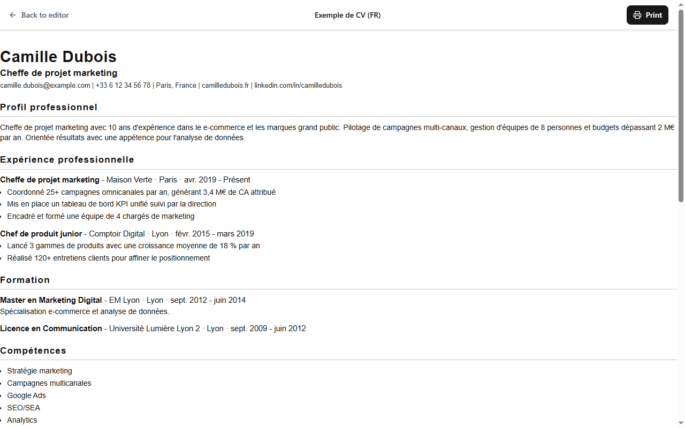

# ATS CV Studio

[English](README.md) | **Français** | [العربية](README.ar.md)

[]() []() [](https://github.com/ayoubghr-qwerty/ats-cv-studio/actions/workflows/ci.yml) []() []() []() []() []()

Un **créateur de CV et de lettres de motivation hors ligne, compatible ATS** — disponible en application de bureau Windows avec Tauri 2, avec exactement la même interface en version web pure. Anglais, français et arabe (RTL complet) inclus.



## Pourquoi ATS CV Studio

- **100 % hors ligne et privé.** Aucun compte, aucun serveur, aucune télémétrie. Tout — y compris l'analyse des imports PDF/DOCX — se passe sur votre machine.
- **Conçu pour les ATS.** Chaque modèle produit une colonne unique de texte simple et sélectionnable, avec des polices standard, des dates et des titres — exactement ce que les logiciels de tri de candidatures (ATS) savent lire. Pas d'icônes, de photos ni de barres de notation qui perturbent l'analyse.
- **16 modèles répartis en 10 familles de mise en page** (Classique, Minimal, Moderne, Exécutif, Technique, Titre, Compact, Focus, Fonctionnel, Professionnel) — tous vérifiés par le linter de règles ATS intégré.
- **Contrôle fin du design.** Police, marges, espacement, style des titres, séparateurs, style des puces, alignement des contacts, séparateurs de listes en ligne, placement des dates, couleurs d'accent… sans jamais compromettre la compatibilité ATS.
- **Importez votre CV existant.** Fournissez un PDF (texte), un DOCX ou un JSON et récupérez un document structuré et éditable — analysé localement, avec une étape de relecture avant tout enregistrement.
- **De vrais exports.** Export PDF silencieux avec texte sélectionnable sur bureau (impression WebView2), DOCX Word avec polices mappées, et sauvegardes JSON de l'espace de travail.
- **Lettres de motivation incluses.** Même système de design, réutilise vos coordonnées de CV, s'exporte aussi en PDF et DOCX.
- **Interface trilingue.** English, Français, العربية — avec une mise en page droite-à-gauche complète pour l'arabe.
- **Annuler/Rétablir, sauvegarde auto, versions.** Chaque document conserve un historique de versions restaurable à tout moment.

## Fonctionnalités

### Éditeur en direct

Modifiez section par section avec un aperçu A4 en temps réel, réorganisez les sections par glisser-déposer, activez/désactivez chaque section, annulez/rétablissez et enregistrez automatiquement. Chaque document possède un historique de versions restaurable.

### Galerie de modèles


Une mise en page représentative par famille plus de vraies variantes (Titre ×3, Compact ×3, Focus ×2, Fonctionnel ×2), chacune affichée avec des données d'exemple — vous voyez le rendu réel, pas une maquette.

### Panneau de design


Treize options de design par document — modèle, police, marges de page, espacement, style des titres, séparateur, alignement des contacts, style des puces, mise en page des listes, disposition des compétences, disposition des langues, placement des dates et couleur d'accent. Un script `lint:templates:ats` garantit que chaque modèle respecte les règles ATS.

### Assistant d'import


Importez un CV depuis un PDF, un DOCX ou un JSON. Les analyseurs reconnaissent les lignes de contact séparées par `|`, les listes de compétences `Catégorie : a, b, c`, les niveaux de langue (y compris CECRL A1–C2), les URLs LinkedIn/GitHub, et plus encore. Les imports PDF et DOCX passent par un brouillon de relecture pour corriger les cas limites avant l'enregistrement. *Tout est analysé localement sur cet appareil.*

### Lettres de motivation


Rédigez une lettre avec les coordonnées du destinataire, l'objet et le corps ; reprenez vos coordonnées directement depuis n'importe quel CV existant. Export aux mêmes formats PDF sélectionnable et DOCX que les CV.

### Plus de captures

| Modèles & design | Éditeur de lettre |
| :---: | :---: |
|  |  |

| Tableau de bord | Arabe — RTL complet |
| :---: | :---: |
|  |  |

## Stack technique

| Couche | Technologie |
| --- | --- |
| Coquille bureau | Tauri 2 (Rust), impression WebView2 vers PDF |
| Frontal | React 19, TypeScript (strict), Tailwind CSS v4 |
| État & données | Zustand + schémas Zod, Dexie (IndexedDB, web) / fichiers JSON (bureau) |
| i18n | i18next — EN / FR / AR, JSON embarqué |
| Import / export | pdf.js, analyse DOCX, docx (export Word) |
| UX | framer-motion, react-hook-form, Radix UI, lucide-react, sonner |
| Qualité | Vitest — **274 tests unitaires**, ESLint, typecheck strict, linter ATS des modèles |
| Build | workspaces pnpm 11 + Turborepo, Vite 8, GitHub Actions CI |

## Organisation du projet

```
ats-cv-studio/
├─ packages/
│  ├─ core/          # schémas Zod, stores, adaptateurs de stockage, SerialQueue, exemples
│  ├─ templates/     # 16 définitions de modèles, rendu, validation ATS
│  ├─ features/      # tableau de bord, éditeur, assistant d'import, réglages, vues d'impression
│  ├─ app-shell/     # routeur, mise en page, en-tête
│  ├─ ui/            # composants UI partagés
│  ├─ i18n/           # bundles de traduction EN / FR / AR
│  ├─ importers/     # analyse PDF / DOCX / JSON
│  └─ exporters/     # export DOCX
├─ desktop/          # application Tauri 2 (backend Rust + export PDF WebView2)
├─ website/          # version web pure du même frontal
├─ e2e/              # suites Playwright de bout en bout (import, RTL, lettres)
├─ scripts/          # vérifications de version, build portable, linter ATS
└─ docs/             # checklist de sortie, spécifications
```

## Démarrage

**Prérequis :** Node.js 22+, pnpm 11 (`corepack enable`), et pour l'application de bureau : Rust stable avec MSVC + le runtime WebView2 (standard sous Windows 10/11).

```bash
pnpm install

# Serveur de dev web → http://localhost:5174
pnpm dev:web

# Application de bureau (Tauri)
pnpm dev:desktop

# Contrôles qualité (les mêmes que la CI)
pnpm test            # 274 tests unitaires
pnpm lint
pnpm typecheck
pnpm check:versions   # cohérence de version sur 6 manifests
pnpm lint:templates:ats

# Builds
pnpm build:web       # build web de production
pnpm tauri:build     # installateurs MSI + NSIS
```

## Téléchargement

Récupérez la dernière version sur la [page des releases](https://github.com/ayoubghr-qwerty/ats-cv-studio/releases) : **installateur MSI**, **setup.exe NSIS**, ou **.zip portable** (avec `SHA256SUMS`). Windows 10/11 x64 avec le runtime WebView2.

- L'application est **non signée** : SmartScreen affichera « Windows a protégé votre PC » — cliquez sur *Informations complémentaires → Exécuter quand même*.
- La version **portable** stocke toutes les données dans un dossier `ATSData` à côté de l'exécutable — parfait pour une clé USB.
- Les étapes de QA manuelle de chaque version sont dans [docs/RELEASE-CHECKLIST.md](docs/RELEASE-CHECKLIST.md).

## Vos données, vos fichiers

- **Bureau :** fichiers JSON bruts (`workspace.json` + un JSON par document) dans votre profil utilisateur — `%APPDATA%\com.atscvstudio.desktop\ATS_CV_Studio\`. Rien n'est envoyé nulle part.
- **Portable :** les mêmes fichiers dans `ATSData/` à côté de l'application.
- **Web :** l'IndexedDB de votre navigateur, local à cet appareil et à ce profil.
- Exportez **tout l'espace de travail** en un seul fichier JSON à tout moment (Tableau de bord → *Exporter l'espace de travail*), et réimportez-le sur n'importe quelle machine.

> **Note sur l'export PDF :** l'export PDF silencieux avec texte sélectionnable passe par le WebView2 de l'application de bureau. La version web utilise la boîte de dialogue d'impression de votre navigateur (mêmes mises en page, même format A4).

## Licence

[MIT](LICENSE) © 2026 ayoubghr-qwerty

Consultez [CHANGELOG.md](CHANGELOG.md) pour l'historique des versions.
