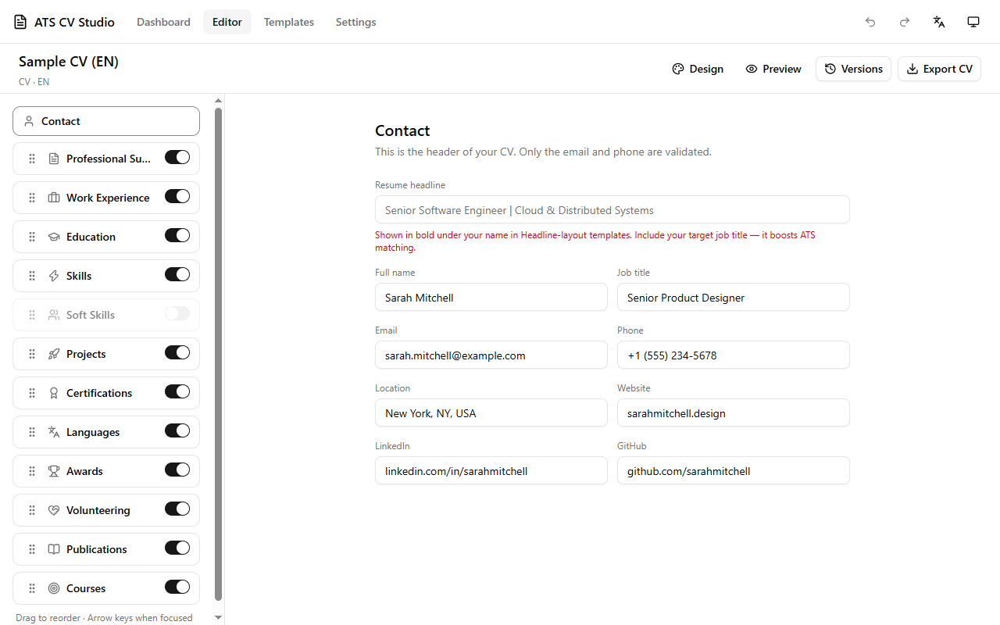
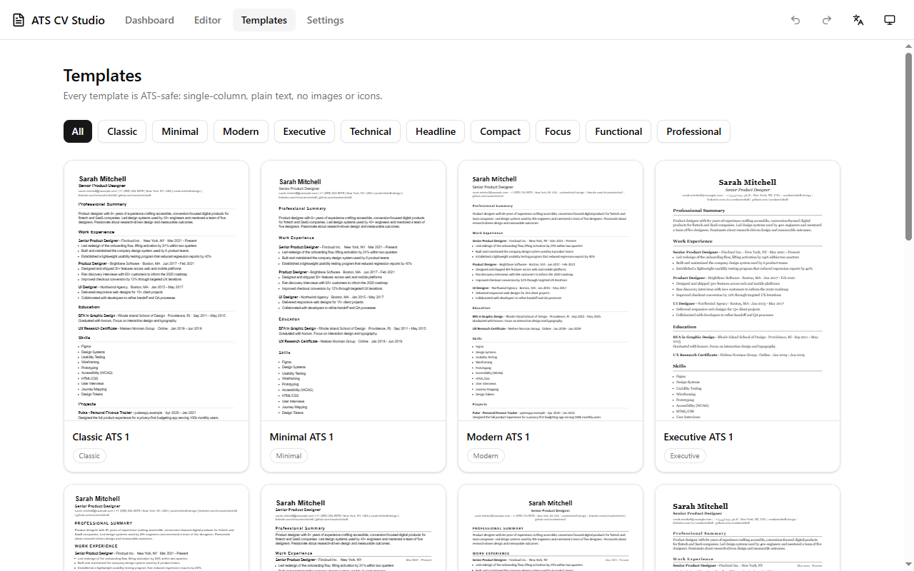
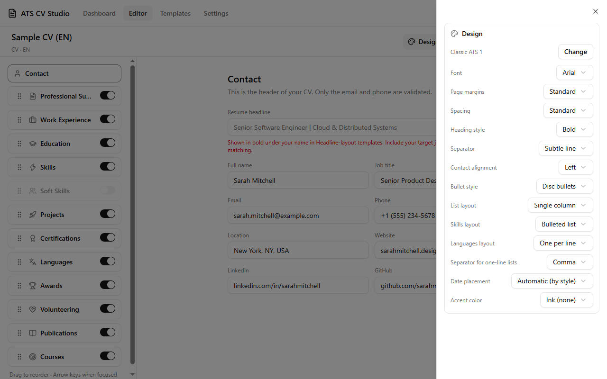
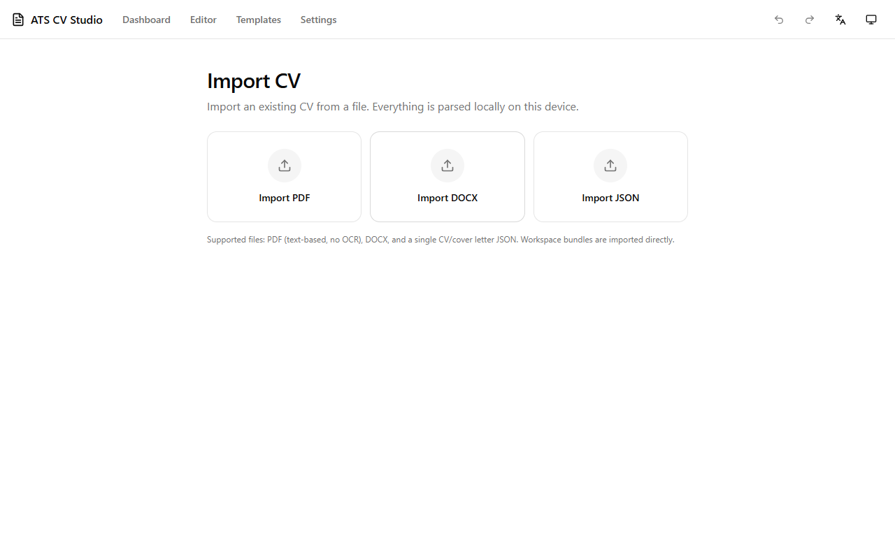
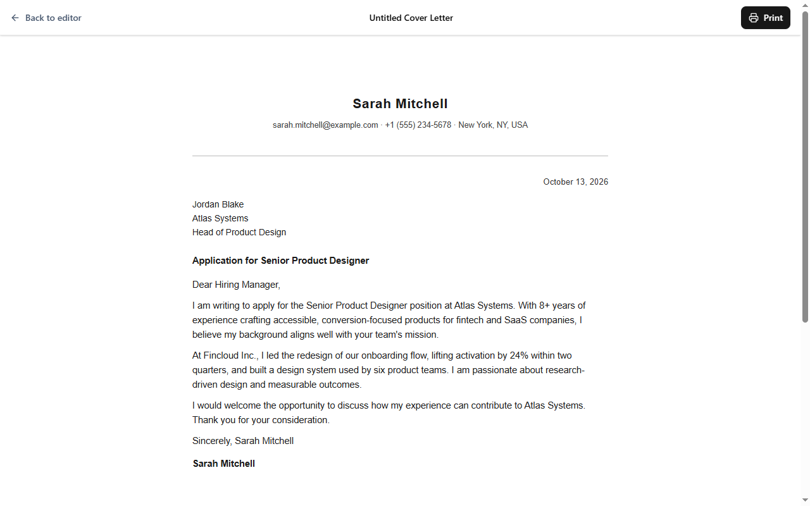
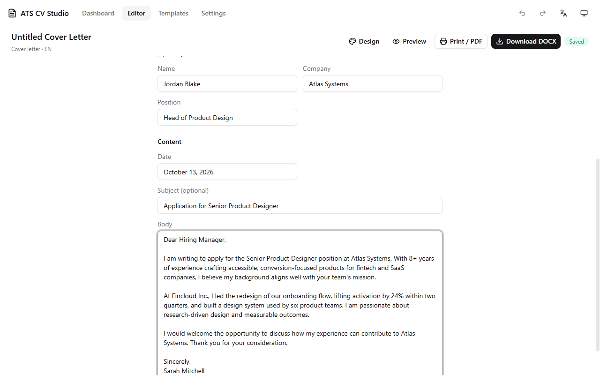
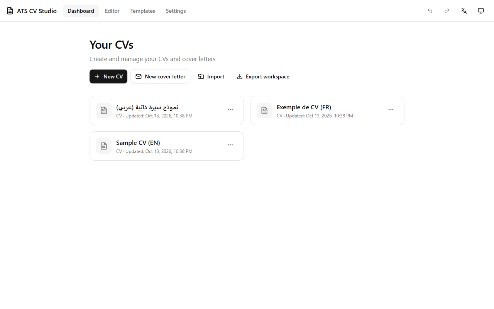
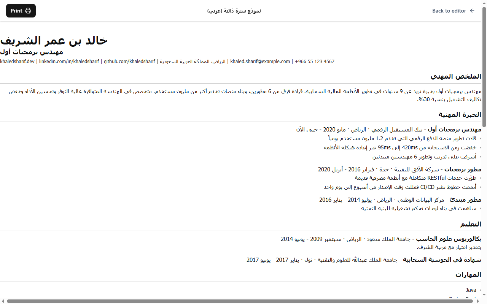

# ATS CV Studio

**[English](README.md)** | [Français](README.fr.md) | [العربية](README.ar.md)

[]() []() [](https://github.com/ayoubghr-qwerty/ats-cv-studio/actions/workflows/ci.yml) []() []() []() []() []()

An **offline-first, ATS-friendly CV & cover letter builder** — built as a Windows desktop app with Tauri 2, with the exact same UI available as a pure web build. English, French and Arabic (full RTL) out of the box.



## Why ATS CV Studio

- **100% offline & private.** No account, no server, no telemetry. Everything — including PDF/DOCX import parsing — happens on your device.
- **ATS-safe by design.** Every template renders a single column of plain, selectable text with standard fonts, dates and headings — exactly what applicant tracking systems can read. No icons, photos or skill-rating bars to confuse a parser.
- **16 templates across 10 layout families** (Classic, Minimal, Modern, Executive, Technical, Headline, Compact, Focus, Functional, Professional) — all verified against the built-in ATS rules linter.
- **Fine-grained design control.** Font, margins, spacing, heading style, separators, bullet style, contact alignment, one-line list separators, date placement, accent colors… without ever breaking ATS safety.
- **Import your existing CV.** Feed in a PDF (text-based), DOCX or JSON file and get a structured, editable document back — parsed locally, with a review step before anything is saved.
- **Real exports.** Silent, selectable-text PDF export on desktop (via WebView2 print-to-PDF), Word DOCX with mapped fonts, and JSON workspace backups.
- **Cover letters included.** Same design system, reuses your CV contact info, exports to PDF and DOCX too.
- **Trilingual UI.** English, Français, العربية — with full right-to-left layout for Arabic.
- **Undo/redo, autosave, versions.** Every document keeps a version history you can restore at any time.

## Features

### Live editor

Edit section by section with a live A4 preview, drag-to-reorder sections, per-section toggles, undo/redo and automatic saving. Every document has a restore-able version history.

### Template gallery



One representative layout per family plus genuine variants (Headline ×3, Compact ×3, Focus ×2, Functional ×2), each rendered with sample data so you can see the real output, not a mockup.

### Design panel



Thirteen design options per document — template, font, page margins, spacing, heading style, separator, contact alignment, bullet style, list layout, skills layout, languages layout, date placement and accent color. A `lint:templates:ats` script keeps every template compliant with the ATS rules.

### Import wizard



Import a CV from PDF, DOCX or JSON. Parsers recognize contact lines with `|`-separated values, `Category: a, b, c` skill lists, language levels (including CEFR A1–C2), LinkedIn/GitHub URLs, and more. PDF and DOCX imports go through a review draft so you fix parsing edge cases before saving. *Everything is parsed locally on this device.*

### Cover letters



Write a cover letter with recipient details, subject and body; pull your contact info straight from any existing CV. Exports to the same selectable-text PDF and DOCX as CVs.

### More screenshots

| Templates & design | Cover letter editor |
| :---: | :---: |
|  |  |

| Dashboard | Arabic — full RTL |
| :---: | :---: |
|  |  |

## Tech stack

| Layer | Technology |
| --- | --- |
| Desktop shell | Tauri 2 (Rust), WebView2 print-to-PDF |
| Frontend | React 19, TypeScript (strict), Tailwind CSS v4 |
| State & data | Zustand + Zod schemas, Dexie (IndexedDB, web) / JSON files (desktop) |
| i18n | i18next — EN / FR / AR bundled JSON |
| Import / export | pdf.js, mammoth-style DOCX parsing, docx (Word export) |
| UX | framer-motion, react-hook-form, Radix UI, lucide-react, sonner |
| Quality | Vitest — **274 unit tests**, ESLint, strict typecheck, ATS template linter |
| Build | pnpm 11 workspaces + Turborepo, Vite 8, GitHub Actions CI |

## Project layout

```
ats-cv-studio/
├─ packages/
│  ├─ core/          # Zod schemas, stores, storage adapters, SerialQueue, samples
│  ├─ templates/     # 16 template definitions, renderer, ATS validation
│  ├─ features/      # dashboard, editor, import wizard, settings, print views
│  ├─ app-shell/     # router, layout, header
│  ├─ ui/            # shared UI components
│  ├─ i18n/           # EN / FR / AR translation bundles
│  ├─ importers/     # PDF / DOCX / JSON parsing
│  └─ exporters/     # DOCX export
├─ desktop/          # Tauri 2 app (Rust backend + WebView2 PDF export)
├─ website/          # pure web build of the same frontend
├─ e2e/              # Playwright end-to-end suites (import, RTL, cover letters)
├─ scripts/          # version checks, portable build, ATS rules lint
└─ docs/             # release checklist, specs
```

## Getting started

**Prerequisites:** Node.js 22+, pnpm 11 (`corepack enable`), and for the desktop app: Rust stable with MSVC + the WebView2 runtime (standard on Windows 10/11).

```bash
pnpm install

# Web dev server → http://localhost:5174
pnpm dev:web

# Desktop app (Tauri)
pnpm dev:desktop

# Quality gates (same ones CI runs)
pnpm test            # 274 unit tests
pnpm lint
pnpm typecheck
pnpm check:versions   # version consistency across 6 manifests
pnpm lint:templates:ats

# Builds
pnpm build:web       # production web build
pnpm tauri:build     # MSI + NSIS installers
```

## Download

Grab the latest release from the [releases page](https://github.com/ayoubghr-qwerty/ats-cv-studio/releases): **MSI installer**, **NSIS setup.exe**, or a **portable .zip** (with `SHA256SUMS`). Windows 10/11 x64 with the WebView2 runtime.

- The app is **unsigned**, so SmartScreen will show "Windows protected your PC" — choose *More info → Run anyway*.
- The **portable** build stores all data in an `ATSData` folder next to the executable — perfect for a USB stick.
- Manual QA steps for each release live in [docs/RELEASE-CHECKLIST.md](docs/RELEASE-CHECKLIST.md).

## Your data, your files

- **Desktop:** plain JSON files (`workspace.json` + one JSON per document) under your user profile — `%APPDATA%\com.atscvstudio.desktop\ATS_CV_Studio\`. Nothing is sent anywhere.
- **Portable:** the same files inside `ATSData/` next to the app.
- **Web:** your browser's IndexedDB, local to this device and this browser profile.
- Export the **whole workspace** as a single JSON file at any time (Dashboard → *Export workspace*), and re-import it on any machine.

> **Note on PDF export:** the silent, selectable-text PDF export runs through the desktop app's WebView2. The web build uses your browser's print dialog instead (same layouts, same A4 output).

## License

[MIT](LICENSE) © 2026 ayoubghr-qwerty

See [CHANGELOG.md](CHANGELOG.md) for release history.
